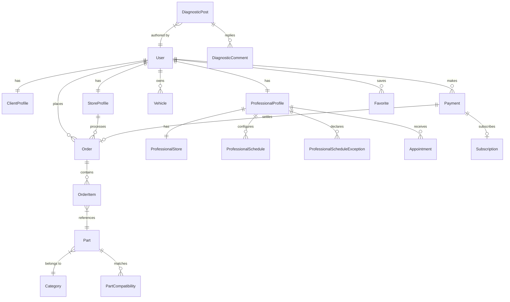

# Siyanati Startup Project Analysis

Welcome to the comprehensive technical and architectural analysis of **Siyanati** ("My Maintenance"), an innovative Algerian startup platform designed to connect vehicle owners (Customers) with auto-mechanics/technicians (Professionals) and spare parts shops (Stores). 

---

## 1. Core Domain & Business Vision

**Siyanati** is an all-in-one automotive ecosystem tailored specifically for the Algerian market. It solves several painful friction points:
*   **For Customers**: Finding qualified mechanics, verifying spare part compatibility (preventing incorrect purchases), scheduling appointments, and obtaining diagnostic help from the community.
*   **For Professionals (Mechanics)**: An online presence to show qualifications, set working hours/schedules, manage client bookings, and monetize through premium subscriptions.
*   **For Spare Part Stores**: Listing inventories, filtering compatible cars, receiving online orders, and shipping parts across Algeria.
*   **Algerian Localization**: Dedicated support for **Wilayas** (provinces), currency in **DZD**, postal account payments (**CCP Compte** with key validation), and online payment methods like **Edahabia** (Algérie Poste).

---

## 2. Technical Stack Overview

The project is structured as a modern full-stack JavaScript application:

### 💻 Frontend Stack
*   **Framework**: React 19 & Vite (build system)
*   **Styling**: Tailwind CSS v4 (incorporating `@tailwindcss/vite` and utilities like `@tailwindcss/forms` and `tailwind-merge` for custom dynamic styles).
*   **State Management**: Zustand (`authStore.js` and `useVehiculeStore.js`) for lightweight, persistent, and fast global state.
*   **Routing**: React Router DOM v7 (featuring layout-level routing and robust role-based navigation guards).
*   **HTTP Client**: Axios (configured with a custom instance, automatic Bearer token injection, and automatic `401 Unauthorized` token refreshing).
*   **UI/Charts**: Lucide React for consistent icons, Framer Motion for premium fluid micro-animations, and Recharts for the admin/professional dashboards.

### ⚙️ Backend Stack
*   **Server**: Node.js & Express (running ES modules/CommonJS with modular routing).
*   **ORM / Database**: Prisma Client configured for PostgreSQL. Takes advantage of advanced relations and indexing.
*   **Validation**: Zod (strict schemas for request payloads, data coercion, and validation).
*   **Security & Protection**:
    *   **Helmet**: Sets HTTP headers for vulnerability protection.
    *   **Express Rate Limit**: Brute-force protection on all API endpoints.
    *   **Bcrypt**: Password hashing with `12` salt rounds.
    *   **JWT Auth**: Standard Access Token (short-lived) + Refresh Token (stored in database/local storage) architecture.
    *   **libphonenumber-js**: Formats and validates Algerian mobile/landline numbers automatically to `E.164` standards (e.g., `+213XXXXXXXXX`).

---

## 3. Database Schema & Data Models

The Prisma ORM configuration (`schema.prisma`) is highly mature and handles the platform's multi-tenant ecosystem seamlessly:

### Key Models & Their Functions:
1.  **User**: Core identity model with a `role` enum (`customer`, `professional`, `store`, `admin`).
2.  **Profiles**:
    *   **ClientProfile**: Holds client-specific details like wilaya, preferred language (`ar` default), and CCP payment accounts.
    *   **StoreProfile**: For spare parts merchants, containing store name, coordinates, verification documents, frozen status, and average rating.
    *   **ProfessionalProfile**: For mechanics, tracking their specialty, experience years, work type (`individuel` vs `avec_magasin`), rate, and active schedule.
    *   **ProfessionalStore**: One-to-one mapping for professionals who run a physical shop.
3.  **Marketplace Models**:
    *   **Brand & Model**: Standardizing car manufacturers (e.g., Renault, Peugeot, Hyundai) and their models/years.
    *   **Vehicle**: Customer-owned cars, including VIN, mileage, health status, and whether it's their default car.
    *   **Part**: Listed parts with OEM reference, SKU, condition (`new`, `used`, `refurbished`), and stock quantities.
    *   **PartCompatibility**: Maps a Part to a Brand, Model, and Year range, allowing customers to search parts that strictly fit their vehicles.
    *   **Order & OrderItem**: Shopping checkout flow capturing delivery types (`home_delivery`, `store_pickup`) and line items.
4.  **Appointments & Booking**:
    *   **ProfessionalSchedule**: Weekly shifts (day of week, start/end hours, slot duration).
    *   **ProfessionalScheduleException**: Days off or custom hours.
    *   **Appointment**: Captures status (`pending`, `confirmed`, `in_progress`, `completed`, `cancelled`), service type, quoted price, and final price.
5.  **Community Diagnostics Board**:
    *   **DiagnosticPost**: Thread describing a car issue with tags for brand/model/year.
    *   **DiagnosticComment**: Replies with markdown/images, allowing marking "accepted answers" (like StackOverflow).
    *   **DiagnosticReaction / DiagnosticSave**: User engagement metrics.
6.  **SaaS Monetization**:
    *   **SubscriptionPlan & Subscription**: Packages for professionals and stores to purchase search visibility and booking tools.
    *   **Payment & PaymentAccount**: Records transaction details via **Edahabia** or **Cash on Delivery**.

---

## 4. Key Architectural Flows

### A. Automatic Token Refresh Flow (Axios + Zustand)
When the React frontend makes a request and the backend replies with `401 Unauthorized` (expired access token):
1.  Axios interceptor intercepts the error.
2.  It uses the stored `refreshToken` from LocalStorage to ping `/auth/refresh`.
3.  The backend validates the refresh token against the database, issues a new `accessToken` and `refreshToken`.
4.  The client updates the Zustand `authStore`, saves the new token, and automatically retries the original request seamlessly.

### B. Compatibility Matching Flow
1.  A merchant uploads a `Part` and declares its compatibility rules in `PartCompatibility` (e.g., *Fits Golf 7 from 2012 to 2020*).
2.  A customer logs in and registers their vehicle (e.g., *Volkswagen Golf 7 2015*).
3.  When searching the catalogue, the app filters parts that match the user's default car brand, model, and year, ensuring high-confidence ordering.

### C. Booking Appointments
1.  A Customer visits a Professional's profile.
2.  The frontend displays available slots based on `ProfessionalSchedule` and blocks out slots already occupied in `Appointment` or cancelled in `ScheduleException`.
3.  Once booked, the Professional receives a dashboard notification to confirm, reschedule, or cancel the request.

---

## 5. Summary of Strengths & Quality Check

*   **Robust Auth Security**: Strong passwords + JWT + Token Refresh cycles prevent session hijacks while keeping a smooth UX.
*   **Database Indexes**: Excellent indexing on relations (`customer_id`, `store_id`, `part_compatibility` lookups) guarantees fast PostgreSQL query execution even under heavy load.
*   **Algerian Localization**: Support for CCP payment details, Wilayas, and Algerian mobile number rules makes the app highly native and user-friendly for local users.
*   **Modular Codebase**: Strong separation of concerns:
    *   Backend separates routes, validation middleware, and business logic controllers.
    *   Frontend leverages global Zustand stores, keeping individual component code clean and declarative.

---

## 6. Development Opportunities & Recommendations

Based on the current state of the codebase, here are high-impact areas where we can expand or optimize Siyanati:

1.  **Diagnostic Page Implementation**: 
    The `/diagnostic` route in `App.jsx` is currently a basic placeholder (`
Diagnostic
`) and `Diagnostics.jsx` is empty. The backend already has excellent controllers (`diagnostic.controller.js`, `diagnosticComment.controller.js`) and Prisma models. Developing the community feed UI would immediately unlock client engagement.
2.  **Payment Gateway Integration**:
    The backend uses a simulated/payment status structure for Edahabia. Setting up a sandbox integration with Algerian payment facilitators (like Satim or local payment APIs) would complete the checkout automation.
3.  **Real-Time Notifications & Chat**:
    Automated status updates (e.g., *Mechanic confirmed your appointment!* or *Your order has shipped!*) could be integrated using WebSockets (Socket.io) or Web Push Notifications.
4.  **Loyalty Program Activation**:
    The database already supports `loyalty_points_earned` and `loyalty_points_used`. We could build the user-facing rewards dashboard to incentivize repeat orders and mechanic bookings.

---

Siyanati is a well-designed, robust, and premium-grade web application with a highly scalable foundation. Let me know what feature, page, or integration you'd like to dive into next!
